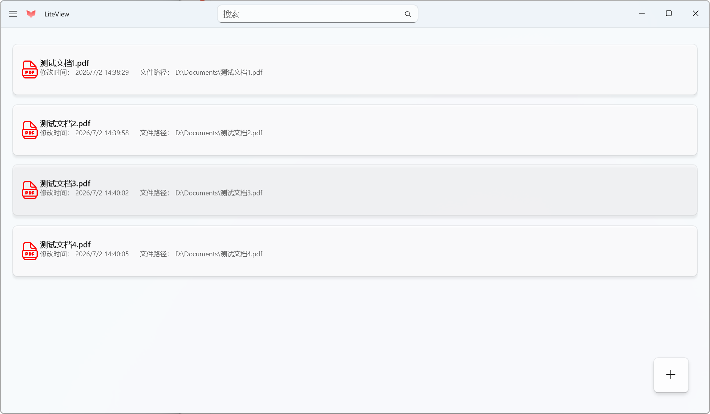
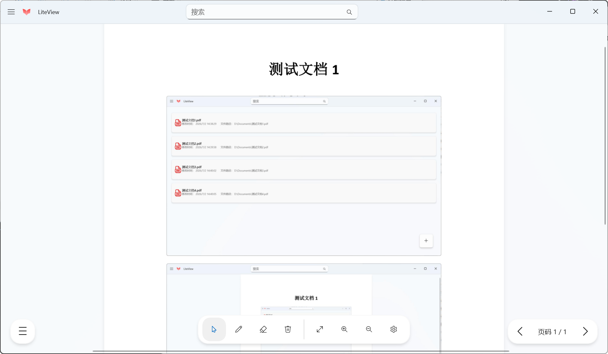

# LiteView

**语言**：[English](README_EN.md)

一款轻量级的原生 **WinUI 3** PDF 阅读器，适用于 Windows 10/11，基于 .NET 10 和 PDFium 构建。

## 功能特性

- **PDF 库管理** — 从本地文件系统添加、浏览和搜索 PDF 文件；元数据以 JSON 格式持久化存储。
- **PDF 阅读** — 流畅的多页滚动浏览，支持缩放（放大/缩小/适合窗口）和页面导航（上一页/下一页/跳转）。
- **批注功能** — 自由画笔（笔工具）支持自定义颜色和笔触粗细；橡皮擦工具可擦除笔迹。
- **主题切换** — 支持系统默认、浅色和深色三种主题。
- **全屏模式** — 沉浸式阅读体验。
- **多语言支持** — 简体中文和英语（未完全支持英语）。
- **更新检测** — 启动时自动通过 Supabase REST API 检查新版本。
- **亚克力背景** — 使用 Mica 材质实现现代界面效果。

 （注：当前版本中批注仅保存在内存中，关闭页面后不会持久化）

## 截图




## 环境要求

- Windows 10（版本 1809 / 内部版本 17763）或更高版本
- [Visual Studio 2026](https://visualstudio.microsoft.com/)，需安装以下工作负载：
  - .NET 桌面开发
  - WinUI 应用程序开发
- [.NET 10 SDK](https://dotnet.microsoft.com/download/dotnet/10.0)
- Windows App SDK 2.5.1（通过 NuGet 还原自动获取）

## 构建与运行

### Visual Studio

1. 打开 `LiteView.slnx`
2. 在解决方案平台下拉菜单中选择目标平台（x86 / x64 / ARM64）
3. 选择启动配置文件：
   - **LiteView (Package)** — 以 MSIX 包应用方式运行
4. 按 **F5** 或 **Ctrl+F5** 构建并运行

### 命令行

```powershell
# 还原依赖
dotnet restore LiteView.slnx

# 构建（打包模式）
dotnet build LiteView.slnx -c Debug -p:Platform=x64
```

## 打包发布
```powershell
dotnet publish LiteView\LiteView.csproj -c Release -p:Platform=x64 -p:GenerateAppxPackageOnBuild=true
```

支持的目标运行时：`win-x86`、`win-x64`、`win-arm64`

## 技术栈

| 组件 | 技术 |
|---|---|
| UI 框架 | WinUI 3（Windows App SDK 2.5.1） |
| 编程语言 | C#（.NET 10） |
| PDF 引擎 | PDFium（通过 PdfiumViewer + P/Invoke） |
| 架构模式 | MVVM（CommunityToolkit.Mvvm） |
| 数据存储 | JSON（System.Text.Json） |
| 绘图引擎 | XAML Shapes（Path / PolyQuadraticBezierSegment） |
| 本地化 | `.resw` 资源文件 |

## 项目结构

```
LiteView/
├── Controls/          # 自定义控件（PdfViewerControl、AnnotationCanvas、PdfListItem）
├── Contracts/         # 服务接口类
├── Controls/          # 控件类
├── EventArguments     # 事件参数
├── Helpers/           # 工具类（主题、窗口、图片、阴影）
├── Models/            # 数据模型（PdfItem、Stroke、VersionInfo 等）
├── Native/            # PDFium P/Invoke 绑定与渲染
├── Pages/             # 应用页面（PdfListPage、PdfViewerPage、SettingsPage）
├── Services/          # 服务（PdfService、NetworkService 等）
├── Styles/            # 数据模板与样式
├── Strings/           # 本地化资源（en-US、zh-CN）
├── ViewModels         # 视图模型
└── Assets/            # 图标与图片
```

## 本地化

在 `Strings/` 目录下添加 `.resw` 文件即可扩展语言支持。当前支持：
- `zh-CN` — 简体中文
- `en-US` — English

## 许可证

本项目基于 [MIT 许可证](LICENSE.txt) 开源。
